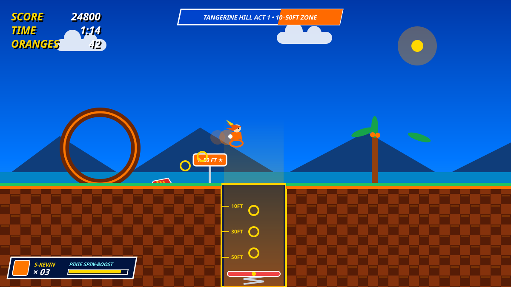
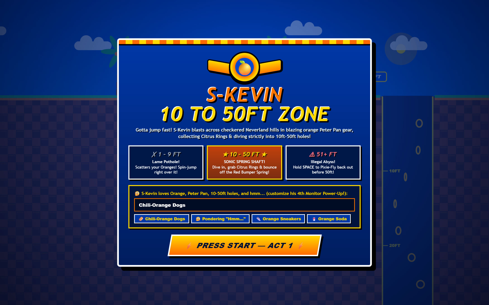
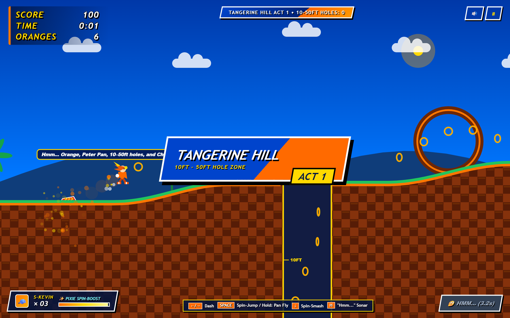
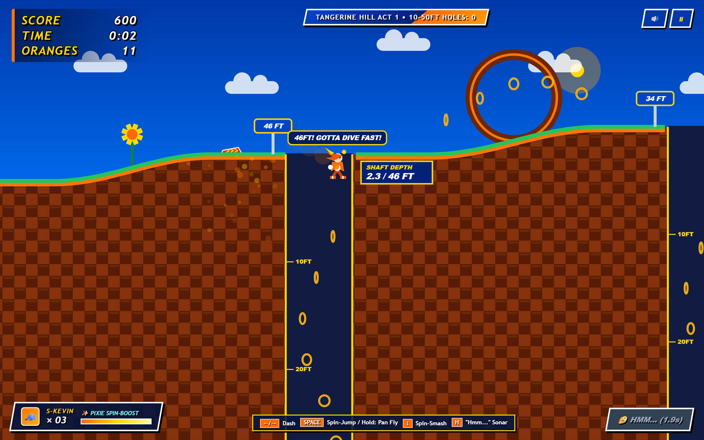
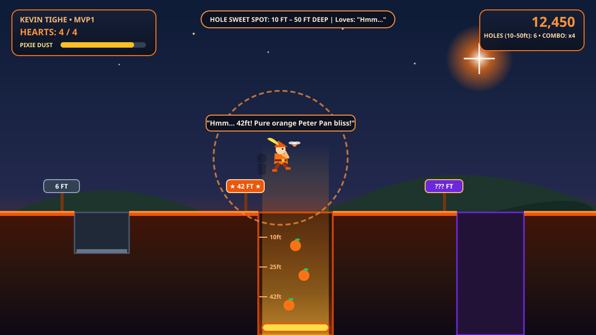
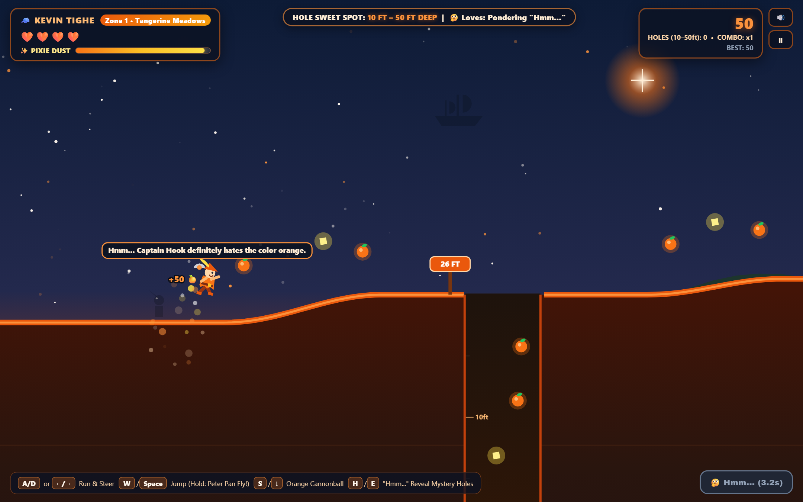

# ⚡ S-KEVIN: 10ft to 50ft Zone (MVP2 — Sonic-Style Edition)

Branch **`S-Kevin`** (**MVP2**) upgrades **Kevin Tighe: 10ft to 50ft Deep** into a classic 16-bit **Sonic the Hedgehog / Sonic Mania**-inspired arcade experience while keeping all of Kevin's core obsessions: **10ft–50ft holes**, **the color orange**, **Peter Pan**, and **pondering *"Hmm..."***.

## ⚡ What's New in S-Kevin (MVP2)
- **Classic Sonic Arcade HUD**: Gold italic `SCORE`, `TIME`, and `ORANGES` counters (blinking red at `0`) + bottom-left `S-KEVIN × 03` life emblem and **Pixie Spin-Boost** bar.
- **Authentic Sonic Ring-Scatter Physics**: Getting hit while holding `ORANGES > 0` scatters bouncing golden-orange Citrus Rings across the stage so you can recover them before losing a life!
- **Sonic Act Title Cards & Checkered Green-Hill-Meets-Neverland World**: 3D checkered brown/orange soil, emerald + tangerine turf, segmented palm trees with orange coconuts, loop-de-loop arches, speed dash pads, Badnik Robo-Crocs, and **Red & Yellow Sonic Bumper Springs** at the bottom of every `10ft–50ft` shaft!

## 📸 MVP2 (`S-Kevin`) Screenshots
### Sonic Emblem Title Screen

### Tangerine Hill Act 1 Gameplay

### 10ft–50ft Sonic Bumper Spring Shaft Dive

---

## 📜 MVP1 Reference Artwork & Screenshots

