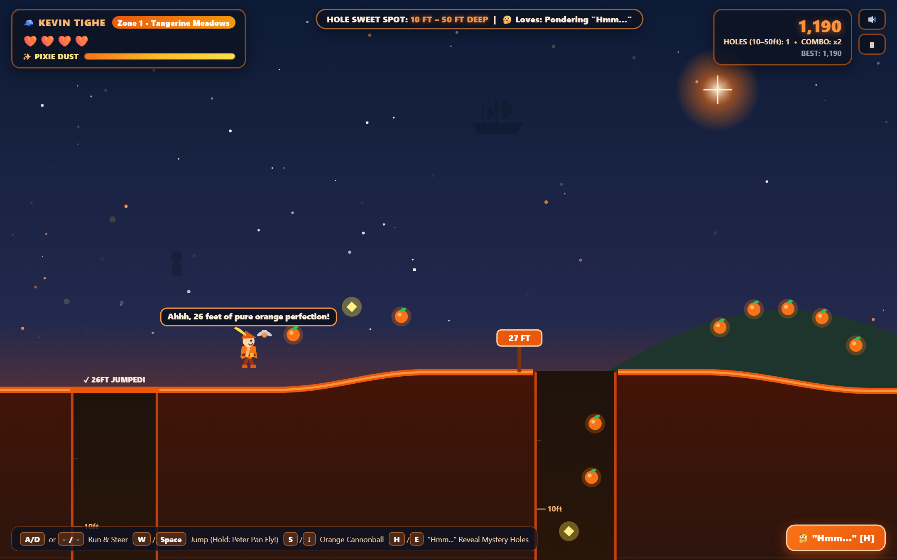

# 🍊 Kevin Tighe: 10ft to 50ft Deep (MVP1)

A playable HTML5 Canvas & Web Audio browser adventure about **Kevin Tighe**—the man who refuses to grow up, wears blazing orange Peter Pan attire, ponders *"Hmm..."*, and strictly jumps into holes **10ft to 50ft deep**.


## 🎮 Play in Browser
Open `index.html` directly in any browser (zero external dependencies) or serve locally:
```bash
python -m http.server 8095
```

## 📸 MVP1 Screenshots
### Title Screen


### Neverland Surface & 10–50ft Hole Gameplay


### Hole Cleared & Combo Chain


## 🕹️ Controls
- **Move / Steer**: `A / D` or `← / →`
- **Jump / Hold for Peter Pan Flight**: `W`, `↑`, or `Space`
- **Orange Cannonball Fast-Dive**: `S` or `↓`
- **`"Hmm..."` Ponder Sonar (Reveal Mystery Holes)**: `H`, `E`, `Shift`, or `Right-Click`
- **Pause / Mute**: `P` / `M`
