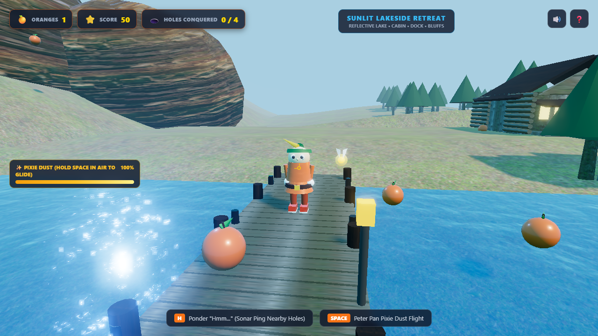
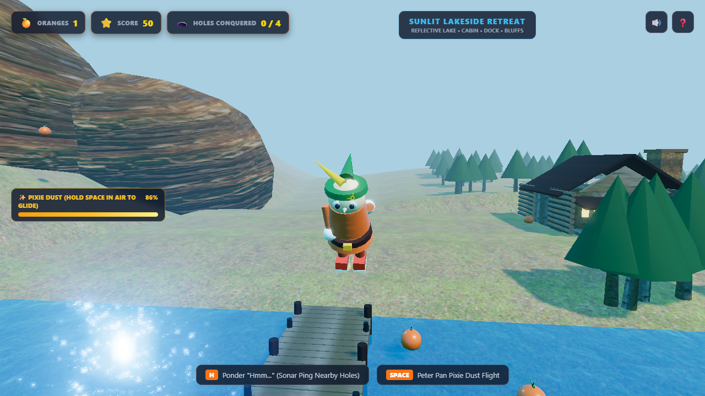
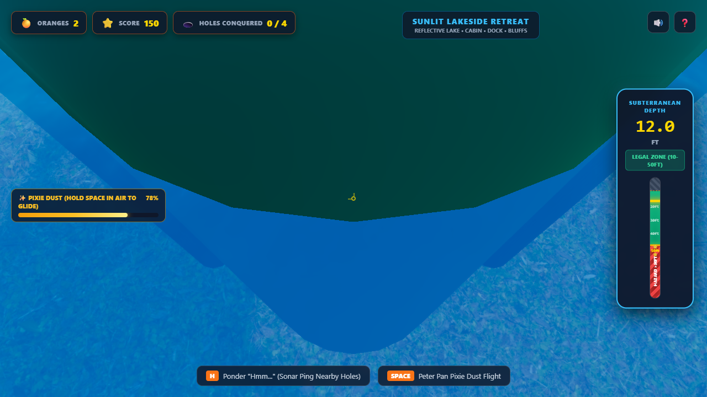
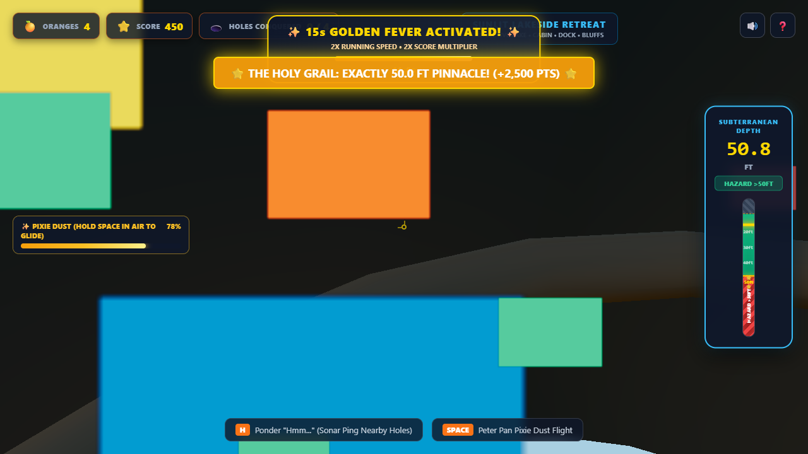

# 🍊 Kevin Tighe: 3D Lakeside Retreat

> *"Hmm... exactly 50.0 feet. Not a centimeter more, not a centimeter less. Pure Neverland perfection."*  
> — **Kevin Tighe**

A fully free-roaming, third-person 3D browser video game starring **Kevin Tighe**—the man who strictly refuses to grow up, wears blazing orange Peter Pan attire, ponders deeply with *"Hmm..."*, and obsessively jumps into holes **strictly between 10.0ft and 50.0ft deep**.

Set against the scenic backdrop of the **Lakeside Retreat**, Kevin explores sunlit pine trails, glides across sparkling lake waters with Peter Pan Pixie Dust, pings hidden sinkholes with his signature sonar, and plunges into subterranean caverns to claim the legendary **50.0ft Holy Grail**.

---

## 🎮 Play Live in Browser

Open the game immediately in any modern web browser with WebGL support:

👉 **[http://localhost:8097](http://localhost:8097)**

*(Self-contained Three.js r160 ES distribution — zero bundler, npm build, or external CDN dependencies required!)*

---

## 📸 Gameplay Screenshots

### 1. Lakeside Retreat Scenic Overview
*A breathtaking panoramic view overlooking the sunlit reflective lake, 24m wooden boardwalk pier, cozy timber cabin with stone chimney, and towering granite bluffs (+22m elevation).*



---

### 2. Character Flight, Pixie Dust & Tinker-Tang Fairy
*Kevin Tighe in his iconic Peter Pan orange tunic and feathered cap gliding above the lakeside shoreline, trailed by golden Pixie Dust sparkle particles, his runaway loose shadow, and the glowing Tinker-Tang fairy companion.*



---

### 3. Subterranean Descent & Calibrated Depth Gauge
*Diving headfirst into the 22.0ft Dockside Plunge Pit with real-time subterranean descent kinetics and the calibrated 0–90ft depth gauge displaying the exact sweet spot legal zone.*



---

### 4. The Holy Grail: Exact 50.0ft Celebration & Golden Fever Mode
*Achieving the pinnacle of Kevin's lifelong obsession: reaching the exact 50.0ft floor of the Pine-Root Cavern, unleashing a 600-particle confetti fireworks explosion, triumphant fanfare crow, radiant Golden Fever aura, and 2x speed boost!*



---

## 📜 Lore & Kevin's Four Obsessions

### 1. The Strict 10ft–50ft Hole Rule
Kevin Tighe does not jump into just any hole. He follows an uncompromising code of subterranean geometry:
* **< 10.0 FT (Too Shallow)**: An insulting ditch! Jumping in triggers an embarrassing rejection buzzer, vertical upward bounce, and radial repulsion away from the hole mouth.
* **10.0 FT – 50.0 FT (The Sweet Spot)**: The legal promised land! Smooth vertical descent, real-time depth telemetry, shaft orange pickups, and a roaring geothermal geyser that propels Kevin skyward back to the surface.
* **EXACTLY 50.0 FT (The Holy Grail)**: The pinnacle achievement of subterranean diving! Awards +2,500 bonus points, plays the triumphant Peter Pan rooster crow, erupts a 600-particle confetti cannon, and grants 15 seconds of **Golden Fever Mode**.
* **> 50.0 FT (Too Deep / Hazard Zone)**: Forbidden territory! Protected by an ominous glowing Crimson Laser Boundary at exactly 50.0ft. Kevin must execute a skillful mid-shaft flight escape before crossing 50.0ft; crossing past 50.0ft breaches safety rules, assessing a -500 point penalty and respawning him at the shaft collar.

### 2. The Color Orange
Everything Kevin wears and covets radiates vibrant orange:
* Articulated orange Peter Pan tunic, scalloped hem, leggings, and pointed boots.
* Golden quill feather adorning his Robin Hood cap.
* Glowing citrus orange collectibles scattered across lakeside trails and subterranean shafts.

### 3. Peter Pan & Neverland Magic
Kevin refuses to grow up. His spirit is bound to Neverland kinetics:
* **Pixie Dust Flight**: Consume sparkling pixie dust to defy gravity, glide across lake chasms, or arrest fatal falls.
* **Tinker-Tang Fairy**: A loyal, glowing 3D fairy companion tracing a graceful Lissajous orbit around Kevin's shoulder.
* **Runaway Loose Shadow**: A detached ground shadow that lags playfully behind Kevin's sprints and jumps.

### 4. Pondering "Hmm..." & The 4th Obsession
Pressing `H` or `E` causes Kevin to strike a classic chin-stroking contemplation pose, releasing an expanding 3D spherical sonar wave that pings nearby holes with color-coded holographic depth rings.
Players can also choose Kevin's customizable **4th obsession** from the title screen:
* 🧀 **Cheddar Cheese Wedges**
* 🥤 **Orange Cream Soda**
* 🪶 **Peter Pan Feather Caps**
* 👟 **High-Top Orange Sneakers**

---

## 🕹️ Controls Guide

| Action | Primary Input | Alternative Input |
|---|---|---|
| **Move / Walk** | `W`, `A`, `S`, `D` | Arrow Keys (`↑`, `←`, `↓`, `→`) |
| **Sprint (2x Speed)** | `Shift` (Hold) | — |
| **Jump / Vault** | `Space` | — |
| **Peter Pan Flight / Glide** | `Space` (Hold in air) | `F` |
| **Orbit Camera** | `Mouse Move` (Drag) | Pointer Lock |
| **Camera Zoom** | `Mouse Wheel` | — |
| **Ponder Sonar ("Hmm...")** | `H` | `E`, `Right-Click` |
| **Mid-Shaft Flight Escape** | `Space` (inside shaft <50ft) | `F` |
| **Mute / Unmute Audio** | `M` | Top-Right HUD Button |
| **Interactive Start / Pause** | `Space` / Click | Escape |

---

## 🏗️ System Architecture

```
kevin-tighe-lakeside/
├── index.html                  # ES module importmap, HTML5 canvas, and responsive HUD overlay
├── style.css                   # Polished arcade UI styling, depth dial, and golden fever banners
├── package.json                # Project manifest and Playwright devDependencies
├── README.md                   # Complete lore, controls, architecture, and verification guide
├── screenshots/                # 4 high-fidelity gameplay screenshots & automated capture script
│   ├── 01_lakeside_retreat_overview.png
│   ├── 02_character_flight_fairy.png
│   ├── 03_subterranean_descent_gauge.png
│   ├── 04_holy_grail_50ft_celebration.png
│   └── capture_screenshots.mjs
├── vendor/
│   └── three/                  # Self-contained Three.js r160 ES distribution & JSM postprocessing
├── assets/                     # CC0 procedural & PBR texture maps (color, normal, roughness)
├── src/
│   ├── main.js                 # Engine coordinator, animation loop, and window.__KEVIN_GAME__
│   ├── config.js               # Physics constants, hole registry, and depth tier thresholds
│   ├── core/
│   │   ├── engine.js           # Three.js WebGLRenderer, ACES tone mapping, UnrealBloom composer
│   │   ├── audio.js            # Web Audio API procedural synthesis (Mixolydian theme, "Hmm...", crow)
│   │   └── textures.js         # Texture manager with automatic procedural fallback generators
│   ├── world/
│   │   ├── landmarks.js        # Spatial registry and landmark factory
│   │   ├── terrain.js          # Multi-elevation heightmap terrain with trails and sandy shoreline
│   │   ├── lake.js             # Reflective lake water mesh with animated ripple normal maps
│   │   ├── dock.js             # 24m wooden boardwalk pier with plank textures and mooring posts
│   │   ├── cabin.js            # Timber log retreat cabin with stone chimney, porch, and lantern
│   │   ├── forest.js           # Instanced pine forest canopy, needle floor, and granite boulders
│   │   ├── bluffs.js           # Massive rocky granite bluffs (+22m elevation) with chasm walls
│   │   └── lighting.js         # 2048x2048 shadow-casting sun, hemisphere sky/ground fill, point lights
│   ├── character/
│   │   ├── kevin.js            # 3D articulated avatar rig in orange attire and feathered cap
│   │   ├── controller.js       # Locomotion state machine, jump impulse, and obstacle avoidance
│   │   ├── camera.js           # Clamped third-person orbit follow camera with raycast collision
│   │   ├── flight.js           # Pixie Dust fuel gauge kinetics and golden particle emitter
│   │   ├── fairy.js            # Tinker-Tang fairy companion in 3D Lissajous orbit
│   │   ├── shadow.js           # Detached runaway loose shadow with ground elevation clamping
│   │   └── sonar.js            # "Hmm..." expanding 3D sonar pulse and depth ping billboards
│   ├── holes/
│   │   ├── holeManager.js      # Landmark hole spatial placement and radial collision registry
│   │   ├── subterranean.js     # 6-phase subterranean descent machine and depth tier enforcement
│   │   ├── geyser.js           # Geothermal geyser upward eruption emitter and launch pad
│   │   └── celebrations.js     # 50ft Holy Grail celebration: 600-particle confetti & Golden Fever
│   ├── items/
│   │   └── pickups.js          # Rotating citrus oranges and 4th obsession thought-bubble items
│   └── ui/
│       └── hud.js              # Live DOM binding for stats, Pixie Dust bar, and depth dial
└── tests/                      # Comprehensive automated headless Playwright test suites
    ├── run-lakeside-tests.mjs  # Unified test runner executing all milestone suites
    ├── verify_m1_lighting_contract.mjs
    ├── verify_m3_subterranean.mjs
    └── challenger_m3_stress.mjs
```

### Key Technical Innovations
1. **Zero External Build Step**: Pure native ES modules leveraging browser `<script type="importmap">` with a vendor-locked Three.js r160 distribution.
2. **Physically Based Rendering (PBR)**: All meshes use `MeshStandardMaterial` or `MeshPhysicalMaterial` mapped with roughness, normal, and albedo channels; zero flat untextured primitives.
3. **Subterranean Kinetics State Machine**: Enforces a strict 6-phase subterranean lifecycle (`INACTIVE`, `REJECTED`, `DESCENDING`, `GEYSER_PROPELLED`, `MID_SHAFT_FLIGHT`, `BREACH_RESPAWNING`) governed by mathematical depth conversion (`ft = meters * 3.28084`).
4. **15-Second Golden Fever Mode**: Features a pulsing golden wireframe sphere aura, radial point light, 2x running speed multiplier, and 2x score multiplier with dynamic HUD countdown.
5. **Procedural Web Audio Synthesis**: Completely procedural sound design synthesizing Mixolydian fanfare melodies, Peter Pan crow harmonics, vocal formant "Hmm..." envelopes, and subterranean geyser rushes.

---

## 🧪 Test Verification Commands

The test suite runs headlessly against the live game server at `http://localhost:8097` using Chromium with SwiftShader WebGL acceleration:

### 1. Run Complete Test Suite (Unified Runner)
```bash
node tests/run-lakeside-tests.mjs
```

### 2. Milestone 3 Subterranean Hole Verification
Validates the 4 landmark holes, `<10ft` shallow rejection bounce, `10ft–50ft` descent/geyser launch, `50.0ft` Holy Grail fanfare, `>50ft` red laser breach, and calibrated depth HUD:
```bash
node tests/verify_m3_subterranean.mjs
```

### 3. Milestone 3 Adversarial Kinetics & Stress Test
Subjected to 30 rapid-fire hole entries, hair-trigger mid-shaft flight escape at 49.5ft without crossing the 50.0ft laser, and 60 continuous frames under 600-particle confetti loads:
```bash
node tests/challenger_m3_stress.mjs
```

### 4. Milestone 1 Environment & Lighting Audit
Verifies the 5+ landmarks, 2048x2048 directional shadow maps, PBR materials, and `window.__KEVIN_GAME__` testability contract:
```bash
node tests/verify_m1_lighting_contract.mjs
```

### 5. Automated High-Fidelity Screenshot Capture
Captures all 4 high-resolution gameplay screenshots into `screenshots/`:
```bash
node screenshots/capture_screenshots.mjs
```

---

## 🌿 Remote Git Branch Publication

This project lives on dedicated branch **`Lakeside-Retreat`** in repository **`https://github.com/organized-nick/Kevin-Tighe`**.

### Branch Isolation Guarantee
* Sibling branches `main`, `MVP1`, and `S-Kevin` remain completely untouched and unmodified.
* Verify branch status on remote:
```bash
git ls-remote origin
# OR
gh api repos/organized-nick/Kevin-Tighe/branches
```
